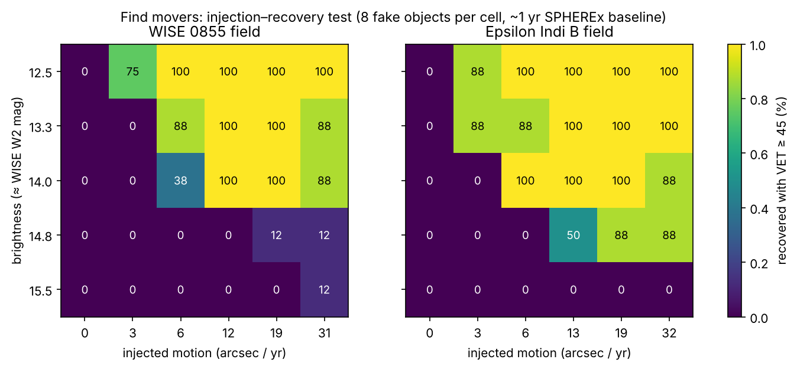

# How well does Wanderer work? (validation)

Everything here was run on real SPHEREx QR2 data. The test scripts live in this folder.

## 1 · Find movers: injection–recovery

**Method.** We put fake moving point sources into the real SPHEREx frames of two clean fields (WISE 0855, Epsilon Indi B) and one bad field (R Draconis, a saturated variable star). We used 8 random empty spots per cell, a Gaussian PSF with σ = 1 px, and a position that moves linearly with each frame's own time stamp. Then we ran the unchanged Find movers and counted a recovery when it reported the object within 2 px with a VET score of 45 or more. Brightness is converted to WISE W2 magnitudes using CatWISE stars in the same cut-outs; the two fields agree on the zero point to 0.02 mag (`inject.js`, `injection_results.json`).

**Results (clean fields, ~1 yr baseline):**

| | Recovered |
|---|---|
| W2 ≲ 14, moving ≥ 12″/yr | **100%** |
| W2 ≈ 14, moving ≈ 6″/yr | 38–100% (depends on the field) |
| W2 ≈ 13, moving ≈ 3″/yr | 0–88% |
| W2 ≈ 14.8 | only fast movers (≥ 19″/yr) in the less crowded field |
| W2 ≈ 15.5 | not recovered |
| **Non-moving fakes** | **0 / 80 false movers** |

**What the test changed.** The first run found a bug: a brightness gate threw away almost every faint mover, and recovery was near zero even for bright fakes. After the fix, the same objects are recovered at the rates above.

**Honest limits.**
- With 6.15″ pixels and about one year of data, SPHEREx movers are limited to objects moving more than a few arcsec per year. Almost all of those are already catalogued. Find movers is a good teaching and checking tool, but it is unlikely to find a new brown dwarf by motion alone.
- In the R Draconis field, recovery is close to random, because the saturated Mira's halo dominates. After this test we added a veto: any uncatalogued change inside or near a saturated star's halo is capped at VET 40, which locks it out of team submission.
- **Wide fields (20′):** bright, non-moving Gaia stars showed 1 px "moves", because image alignment isn't perfect over a large field. A sixth test now checks whether a catalogued star's proper motion predicts a visible shift (≥ 0.25 px). If it doesn't, the change is flagged as an artefact and capped at VET 40. In a 20′ test field (CDF-S), 12/12 such false moves were caught; Barnard's Star and Epsilon Indi B still pass.
- The fakes have the same signal-to-noise in every detector. Real cold brown dwarfs are much brighter at 4–5 µm than at 1 µm.

## 2 · Spectral classifier

**Field-star control.** We took 49 Gaia-matched ordinary stars from the challenge and survey cut-outs (excluding each target), and the classifier labelled **49/49 "Normal star"** (`field_star_control.json`). An earlier threshold labelled 5 of them "infrared excess"; requiring the colour to be red even at its 2σ lower bound fixed that.

**Challenge targets.** The rules were set while looking at these, so this is a sanity check, not a blind test:

| Target | Classifier | Known |
|---|---|---|
| Epsilon Indi B | T-type brown dwarf (high): 82% water dip, 74% methane trough | T1 + T6 binary ✓ |
| WISE 0855−0714 | Y-type / very cold brown dwarf (high): very red and moving | Y4, ~285 K ✓ |
| 10 Hygiea | Asteroid (sunlight + heat) | asteroid ✓ |
| 3I/ATLAS | Comet, CO₂ (tentative) | CO₂-rich interstellar comet ✓ |
| RW Aurigae | Strong IR excess (low) | young star with a disk ✓ |

## 3 · Red-source survey (the blind test)

**Question.** Very red WISE sources (W1−W2 > 1.5) are either cold brown dwarfs or distant dusty active galaxies (AGN). Can SPHEREx spectra tell them apart?

**Sample.** CatWISE2020 sources in 8 high-latitude fields of 6° radius, with 8 < W2 < 14 and clean flags, about 480 red sources in total. Proper motion gives an independent label:
- **30 "not moving"** (< 2σ): the brightest such sources, most likely AGN.
- **8 "moving"** (> 0.15″/yr at > 5σ): every one we found at |b| > 15° in 18 search cones.

Each source got a SPHEREx pack of up to 180 QR2 frames (`run_survey.py`). The in-browser classifier was then run on each one (`survey_results.json`, `summarise.py`).

**Result 1: classifier v1 failed, and we found out why.** v1 measured "methane" with the CH₄−M colour. It called **6 of the first 8 non-moving red sources brown dwarfs**, several with "high" confidence (`classifier_v1_blind_result.md`). A steep red AGN power law makes that colour look like methane.

**Fix (v2).** Methane is now a *trough*: flux at 3.35 µm compared with the 2.2–3.95 µm continuum in log–log. The spectrum is also combined with catalogue proper motion.
- Field stars: trough = 0 ± 8%. Epsilon Indi B: 74%.
- **Non-moving red sources: 0/26 show a methane trough.** This uses the spectrum only, with no motion.
- With motion added: **0/30 non-moving sources labelled brown dwarf**, and 29/30 labelled "dusty active galaxy (likely)".

**Result 2: SPHEREx doesn't see most of the "moving" sources.** Of the 8 moving red CatWISE sources:
- 4 are **not detected at all** (< 2σ at 4.4–5 µm), although at W2 = 12.7–14.0 they should be: WISE 0855 (W2 ≈ 13.9) is clearly detected, and the injection test recovers 100% of fakes at W2 ≈ 14. Most of them have extreme W1−W2 (4–5.5). We think they are spurious catalogue entries (artefacts or blends with a false motion), but this should be checked by eye in unWISE images.
- 1 is saturated, 1 has noisy colours, and 1 has normal-star colours (probably a blend).
- 1 (CWISE J173610.35+671424.1, W1−W2 = 4.34, 0.39″/yr) is labelled **"cold brown dwarf" (medium)**. Its SPHEREx detection is weak (about 2σ in D6), so treat it as a lead, not a discovery. We could not check SIMBAD from our build machine.

**What this means.**
1. On their own, SPHEREx colours from a single QR2 season can't separate Y dwarfs from AGN at W2 ≈ 13. The methane trough plus motion can.
2. SPHEREx is useful as an **independent check of catalogue candidates**: half of the "fast, extremely red" CatWISE entries we tested don't hold up.
3. The sample is small (38 objects) and drawn from about 900 deg². These are first numbers from a hackathon, not a survey paper.
